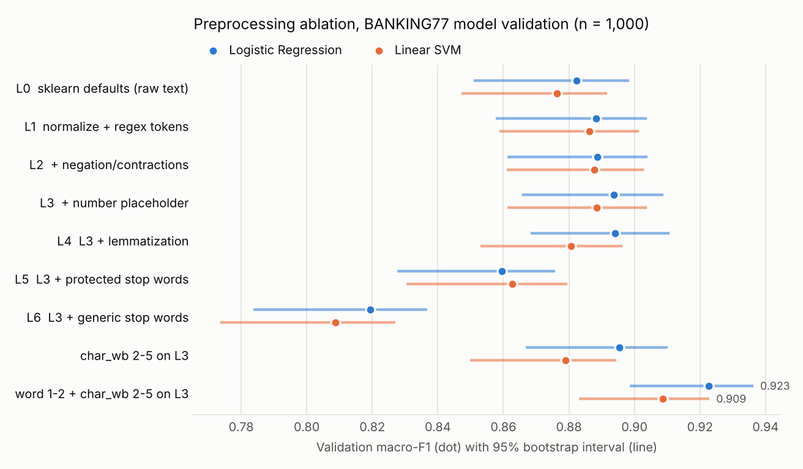
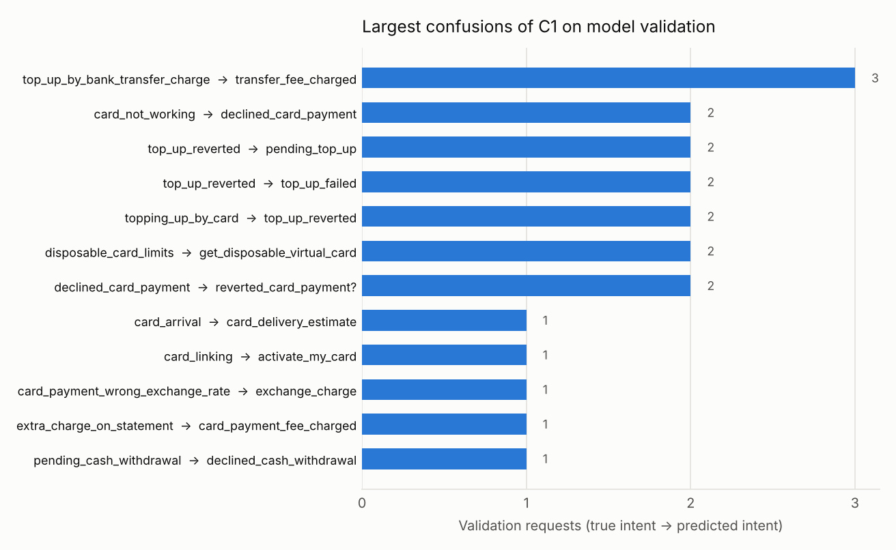

# Development results: preprocessing ablation and lexical classifiers (C1/C2)

Run: 7 November 2026 · protocol `configs/experiment.json` (hash `b7938aa546ed`) · 2-vCPU Linux sandbox, Python 3.13, scikit-learn 1.9.1, spaCy 3.8.18.

**Scope.** All numbers below are on the **model-validation partition (1,000 requests, 3–18 per intent)** of official training. Models were fitted on the fitting partition (8,003 requests). The routing-validation partition and the official test set were not used. These are development numbers for choosing a configuration, not final results, and they are optimistic for the selected configuration because it was chosen on this same partition.

## 1. Data audit (official training only)

| Finding | Count | Consequence |
| --- | --- | --- |
| Requests | 10,003, 77 intents (35–187 per intent, median 127) | Macro-F1 as primary metric |
| Whitespace irregularities (double spaces, leading/trailing newlines) | 464 (10 multi-line) | Light normalization in both branches |
| Non-ASCII characters | £ ×30, € ×21, no-break space ×2, … ×1 | NFKC + ASCII mapping; currency kept as a token |
| Requests with an `n't` contraction | ~1,520 | Negation-preserving expansion |
| Exact duplicates (NFKC, casefold, whitespace) | 4 groups / 8 rows, no label conflict | Grouped |
| Loose duplicates (punctuation/currency differences) | 31 groups / 62 rows, 1 label conflict ("Has my top up gone through?": `pending_top_up` vs `top_up_reverted`) | Grouped; conflict kept as published |
| Near-verbatim copies (word TF-IDF cosine ≥ 0.90) | 108 pairs, 106 same-label | Grouped; largest group 5 rows |
| Frozen partitions | 8,003 / 1,000 / 1,000 | All 77 intents in each |

## 2. Preprocessing ablation

Each row is the best setting of that variant over n-grams and `C` ∈ {0.1, 1, 10, 100}. Δ is the paired-bootstrap difference in macro-F1 from the comparison row (1,000 resamples). "Changed predictions" counts validation requests whose predicted label differs between the two rows.

| Step | LR macro-F1 [95% CI] | LR Δ vs comparison [95% CI] | SVM macro-F1 [95% CI] | SVM Δ vs comparison [95% CI] |
| --- | --- | --- | --- | --- |
| L0 sklearn defaults on raw text | 0.882 [0.851, 0.898] | – | 0.876 [0.847, 0.892] | – |
| L1 normalize + regex tokenizer (vs L0) | 0.888 [0.858, 0.904] | +0.006 [−0.005, +0.017] | 0.886 [0.859, 0.901] | +0.010 [−0.001, +0.022] |
| L2 + negation/contractions (vs L1) | 0.889 [0.861, 0.904] | +0.000 [−0.019, +0.022] | 0.888 [0.861, 0.903] | +0.002 [−0.005, +0.008] |
| L3 + number placeholder (vs L2) | 0.894 [0.866, 0.909] | +0.005 [+0.002, +0.010], 7 changed predictions | 0.889 [0.861, 0.904] | +0.001 [0.000, +0.003], 1 changed |
| L4 L3 + spaCy lemmas (vs L3) | 0.894 [0.868, 0.911] | +0.000 [−0.014, +0.016] | 0.881 [0.853, 0.896] | −0.008 [−0.024, +0.008] |
| L5 L3 + protected stop words (vs L3) | 0.860 [0.828, 0.876] | **−0.034** [−0.058, −0.014] | 0.863 [0.830, 0.880] | **−0.026** [−0.045, −0.007] |
| L6 L3 + generic stop words (vs L3) | 0.819 [0.784, 0.837] | **−0.074** [−0.102, −0.051] | 0.809 [0.774, 0.827] | **−0.080** [−0.105, −0.057] |
| char_wb 2–5 on L3 (vs L3 words) | 0.895 [0.867, 0.910] | +0.002 [−0.019, +0.020] | 0.879 [0.850, 0.894] | −0.010 [−0.029, +0.010] |
| word 1–2 + char_wb 2–5 on L3 (vs L3 words) | **0.923** [0.898, 0.936] | **+0.029** [+0.016, +0.046] | **0.909** [0.883, 0.923] | **+0.020** [+0.008, +0.034] |

What the evidence supports, and what it does not:

- **Stop-word removal hurts clearly**, even with negations, wh-words, modals, and label-name words protected. The generic list removes `not`, `why`, `top`, `up`, `back`, `get`; the protected list still removes `back`, `i`, `was`, and similar words that distinguish requests such as "get my money back". Both stay off.
- **Adding character n-grams to word n-grams is the only step with a clear gain** for both classifiers. Character n-grams alone are not better than words; the union is. A plausible reading (not tested separately) is that character n-grams absorb spelling variants and morphology while word bigrams keep phrase-level cues.
- **Normalization/tokenization, negation handling, and lemmatization show no difference larger than validation noise.** Their intervals include zero. They are kept for reasons decided before the run (robust handling of `can't`/`cant`/`cannot`, curly apostrophes, and newlines in requests arriving through the API), not because validation proved a gain. Lemmatization is not used: it costs a spaCy dependency and gave no measurable benefit (slightly negative point estimate for SVM).
- **The number placeholder's gain is real on this partition but tiny**: it changes 7 of 1,000 LR predictions.

## 3. Lexical candidates

Both families selected the same representation: L3 preprocessing, word 1–2-gram TF-IDF + `char_wb` 2–5 TF-IDF (32,369 features), fitted on 8,003 requests. All 129 fits converged.

| Family | Classifier | `C` | Macro-F1 [95% CI] | Accuracy [95% CI] | Top-3 acc. | Fit time | Warm batch-one p50 / p95 |
| --- | --- | --- | --- | --- | --- | --- | --- |
| C1 | Logistic Regression | 100 | 0.923 [0.898, 0.936] | 0.921 [0.903, 0.938] | 0.967 | 15.0 s | 1.10 / 1.48 ms |
| C2 | Linear SVM | 1 | 0.909 [0.883, 0.923] | 0.910 [0.891, 0.927] | 0.966 | 2.7 s | 1.23 / 2.27 ms |

`C` = 100 for C1 is the grid's upper edge, so the pre-registered edge rule fitted `C` = 1000 once; it scored 0.897 and was not adopted. Latency is from the sandbox and is only indicative; the `select` stage re-measures all four candidates on one machine. Saved models are about 20 MB each (`artifacts/models/`, not in git).

The C1-vs-C2 gap (0.014) is within the overlap of their intervals; this partition cannot say that LR is better than SVM in general.

## 4. Development error analysis (C1, model validation)

C1 makes 79 errors on 1,000 requests; the correct intent is in the top three for 96.7%. The weakest intents are in the top-up family (`top_up_reverted` recall 0.67, `top_up_by_bank_transfer_charge` 0.67, `topping_up_by_card` 0.73) and `compromised_card` (0.78). The largest confusions are between intents that BANKING77 itself separates by a fine distinction (Casanueva et al. give reverted vs failed top-up as an example): `top_up_by_bank_transfer_charge` → `transfer_fee_charged`, `top_up_reverted` → `pending_top_up`/`top_up_failed`, `card_arrival` → `card_delivery_estimate`. Several confident errors look like label ambiguity rather than model failure, for example "My transfer is pending too long." labelled `balance_not_updated_after_bank_transfer` and predicted `pending_transfer`. These belong in the report's error analysis, not in a relabelling step.

## 5. Not done yet

- **C3/C4 (frozen MiniLM):** implemented and tested end to end with a stand-in encoder, but not run, because the Hugging Face hub was blocked in the sandbox. Run `python -m banking_nlp.experiments embeddings` on a team machine.
- **Deployment freeze:** `select` needs all four candidates and measures latency on one machine.
- **Routing threshold, difficulty slice, test scoring:** after the freeze, in that order.

## 6. Published results for context (not comparable)

| Source | BANKING77 result | Why not comparable |
| --- | --- | --- |
| Casanueva et al. (2020) | 92.81% USE, 93.01% ConveRT, 93.36% USE+ConveRT, 93.66% fine-tuned BERT (accuracy, full data, official test) | Official test set; all 10,003 training requests; MLP on different encoders |
| Qi et al. (2021) | 92.1% DistilBERT, 94.1% RoBERTa (accuracy, official test) | Same as above, different models and protocol |
| Jev experiment (2026) | 92.40% accuracy, macro-F1 0.9235 (official test) | Hosted decision model with retrieved examples; test set |

Our numbers are validation-partition scores from 8,003 training requests. They must not be placed in the same column as these.

## References

- Casanueva, I., Temčinas, T., Gerz, D., Henderson, M., Vulić, I. (2020). Efficient Intent Detection with Dual Sentence Encoders. NLP4ConvAI, 38–45. https://aclanthology.org/2020.nlp4convai-1.5/
- Qi, H., Pan, L., Sood, A., Shah, A., Kunc, L., Yu, M., Potdar, S. (2021). Benchmarking Commercial Intent Detection Services with Practice-Driven Evaluations. https://arxiv.org/html/2012.03929v2
- Reimers, N., Gurevych, I. (2019). Sentence-BERT: Sentence Embeddings using Siamese BERT-Networks. EMNLP-IJCNLP, 3982–3992. https://aclanthology.org/D19-1410/
- Jev BANKING77 experiment (GitHub repository by simonmesmith). https://github.com/simonmesmith/jev-banking77-experiment
- BANKING77 data, CC-BY-4.0: https://github.com/PolyAI-LDN/task-specific-datasets (commit `57ec275`), card: https://huggingface.co/datasets/PolyAI/banking77
